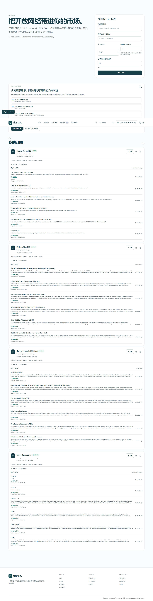

# Fitimart

**A static-first, RSS-powered content marketplace with a configurable virtual economy.**

[简体中文](README.zh-CN.md) · [Live demo](https://styayur.github.io/fitimart/) · [Roadmap](https://github.com/styayur/fitimart/issues/25) · [Documentation](docs/ARCHITECTURE.md)

**Fitimart is simulation-only.** It does not process real money, sell real provider access, create cryptocurrency, or grant ownership rights. Public feeds, CORS proxies, and machine translation are third-party best-effort services with their own availability, limits, and privacy policies.



## What changed in v0.2.0-alpha.1

- Rename and identity migration from Mini Market to **Fitimart**.
- RSS 2.0, Atom, and JSON Feed subscriptions with stable deduplication.
- Client-side direct fetch plus configurable public CORS proxy fallbacks and IndexedDB cache recovery.
- Feed-item product origin metadata and a dedicated subscription manager.
- Exact BigInt-backed six-decimal monetary accounting with serialized string amounts.
- Configurable initial credit, ISO 4217/custom display units, precision, and currency pattern.
- Browser-language detection, explicit language override, English/Simplified Chinese UI, and optional MyMemory translation.
- Gold-coin purchase celebration, animated balance, receipt, collection update, and duplicate-settlement guard.
- Versioned storage migration from `mini-market-demo-v1`, user-data export/import, and recoverable migration backups.
- Static GitHub Pages subpath verification and scheduled live-service acceptance.

## Try it

1. Open **Feeds** and subscribe to a public RSS, Atom, or JSON Feed.
2. Review imported entries, provenance, source language, and optional machine translation.
3. Add a curated or imported item to the bag and complete the simulated checkout.
4. Inspect the exact receipt, collection, wallet activities, language preference, and economy settings.

A fresh wallet starts with **1,000,000,000,000 USD (10^12)** in virtual credit. Changing the initial-credit setting affects future wallet initialization only. Resetting the current wallet is an explicit, recorded action.

## Simulation boundary

- Every balance, order, receipt, top-up, and backing is local simulation data.
- No real payment gateway, account, financial instrument, provider entitlement, or conversion rate is involved.
- Changing the display currency never converts the balance or invents an exchange rate.
- Feed content remains attributed to its publisher. A simulated pass does not unlock paid content or real services.
- Public proxy providers and MyMemory may see requested URLs or submitted text under their own policies.

## Development

Use Node.js 24, matching CI:

```sh
git clone https://github.com/styayur/fitimart.git
cd fitimart
npm ci
npm run dev
```

Run the complete local verification:

```sh
npm test
npm run typecheck
npm run lint
npm run build
python -m pip install -r scripts/requirements-browser.txt
python -m playwright install chromium
python scripts/check_browser.py
```

Live-service acceptance is intentionally separate and is not used as a deterministic fixture test:

```sh
npm run test:live
```

It tests several public feeds, both configured proxy endpoints, RSS/Atom/JSON Feed import, marketplace creation, and one real MyMemory translation. Results vary with third-party availability and quotas.

### Static export and GitHub Pages

The build is a static export in `out/`. Preview it with any static file server, not `next start`:

```powershell
$env:NEXT_PUBLIC_BASE_PATH = "/fitimart"
npm run build
python tests/pages-subpath.spec.py
```

The Pages workflow deploys on a push to `main`. Production URL: <https://styayur.github.io/fitimart/>.

## Architecture

```text
app/                         static routes, feed manager, imported product route
components/                  UI and the client marketplace provider
data/                        curated catalogue and future concepts
lib/
  money.ts                   exact fixed-point arithmetic and formatting
  commerce.ts                pure settlement calculation
  storage.ts                 schema v2, legacy migration, export/import
  catalog-service.ts         curated + RSS + retained-item catalogue view
  feed/
    parser.ts                RSS 2.0, Atom, JSON Feed validation + parsing
    proxy-service.ts         direct → proxy adapters → cache recovery
    feed-cache.ts            IndexedDB raw-response cache
    feed-service.ts          refresh policy, dedupe, status, backoff
  translation/               replaceable providers and translation cache
  services/                  wallet, order, collection, and storage services
types/                       typed marketplace, feed, and economy models
tests/                       deterministic fixtures and browser acceptance
```

Read [the architecture notes](docs/ARCHITECTURE.md), [RSS guide](docs/RSS.md), [proxy/provider notes](docs/PROXY-PROVIDERS.md), [translation notes](docs/TRANSLATION.md), [currency specification](docs/ECONOMY.md), and [migration report](docs/MIGRATION.md).

## Data, privacy, and migration

- Active state uses `fitimart-marketplace-v2`.
- Legacy `mini-market-demo-v1` data is read and migrated without resetting balances, orders, favorites, watched concepts, collections, created concepts, or backings.
- Raw feed responses are cached in IndexedDB; subscriptions and imported item metadata are versioned in local storage.
- Feed URL validation blocks credentials, non-HTTP(S) schemes, localhost, private, and internal address literals.
- Feed HTML is reduced to sanitized plain text before rendering. The app never injects imported HTML.
- Export/import is available in **Settings**. JSON never contains raw BigInt values.
- Clearing browser storage removes the local experience. There is no account, cross-device sync, or backend authority.

## Known limitations

- Public proxies and MyMemory have no uptime, latency, quota, or language-coverage guarantee.
- Browser-side DNS rebinding cannot be fully solved by URL validation alone; do not subscribe to private endpoints.
- Feed refresh only runs on demand or while an app tab is visible.
- The alpha import surface keeps the newest 40 parsed entries per refresh and retains previously imported items in local state.
- Interface localization currently ships English and Simplified Chinese; optional content translation depends on MyMemory coverage.
- There is no multi-tab transaction lock, backend settlement authority, or real entitlement delivery.
- Live acceptance results are point-in-time observations, not service commitments.

## Contributing and security

See [CONTRIBUTING.md](CONTRIBUTING.md) and [SECURITY.md](SECURITY.md). Report exploitable issues privately. Do not put API keys, private feed URLs, or personal data into public proxy requests.

## License

[Mozilla Public License 2.0](LICENSE). Third-party names and feed content remain subject to their owners' rights and terms.
