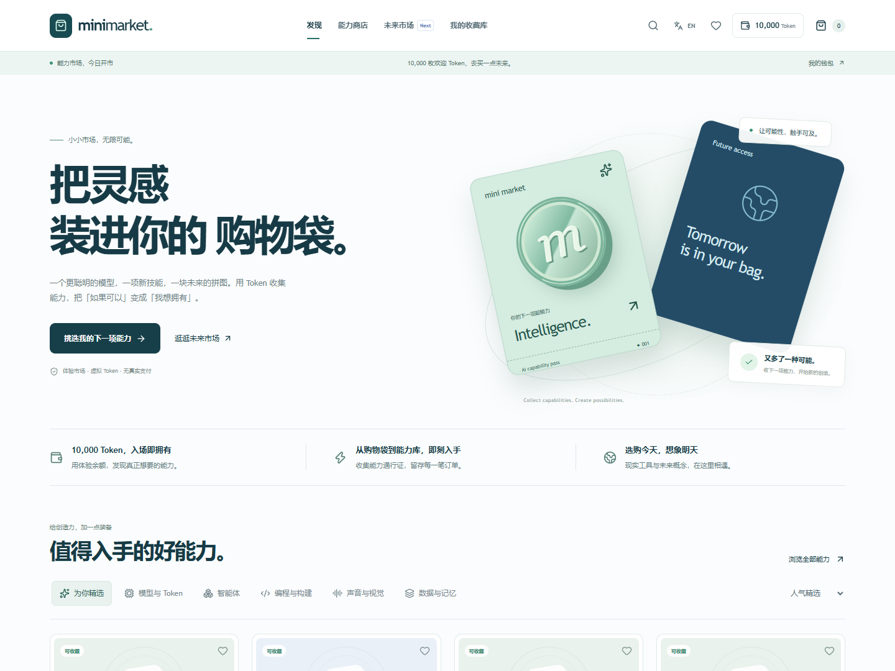

# Mini Market

A simulation-only marketplace for exploring AI capabilities and speculative future concepts.

[简体中文](README.zh-CN.md) · [Live demo](https://styayur.github.io/mini-market/) · [Issues](https://github.com/styayur/mini-market/issues)

**Experimental.** Tokens are free demo units. Purchases grant no real API access, inference credits, subscriptions, cryptocurrency or asset rights. Product capabilities/prices are a hand-maintained catalogue snapshot; consult the provider for current service facts. Future concepts and initial support metrics are illustrative, with no delivery promise.



## Try the experience

Start with 10,000 demo Tokens, browse passes or starter bundles, add 1–99 of each pass, review the bag and check out. Insufficient balance can be topped up for free. Save a text receipt and inspect orders, collection quantities and wallet history. Watch/support speculative concepts or create a local concept in the concept lab.

Primary shopping flows support Chinese and English; technical catalogue text and some editor screens remain English. The design includes keyboard focus, Escape handling, narrow layouts and reduced-motion preferences.

All wallets, orders, collections and locally created concepts live in the current browser. Clearing storage or resetting settings deletes that local experience; there is no account, shared inventory or cross-device sync. If storage is disabled, only the current page session works. Tabs have no transaction lock and the app must not be used for real commerce.

## Develop and test

Use Node.js 24, as in CI:

```sh
git clone https://github.com/styayur/mini-market.git
cd mini-market
npm ci
npm run dev
```

Open `http://localhost:3000`. From the root:

```sh
npm test
npx tsc --noEmit
npm run lint
npm run build
```

The build statically exports `out/`; `next start` is not the preview command for this export. For a root-path export:

```sh
python -m http.server 3001 --directory out
```

Optional browser regression tests require a running app plus Python Playwright:

```sh
python -m pip install playwright
python -m playwright install chromium
```

The scripts default to installed Microsoft Edge. To use downloaded Chromium in PowerShell:

```powershell
$env:BROWSER_CHANNEL = 'chromium'
$env:BASE_URL = 'http://localhost:3000'
python tests/storefront.spec.py
python tests/commerce-browser.spec.py
```

Tests cover cart/checkout, duplicate-payment protection within the page, persistence, receipts, wallet/concept flows and responsive route overflow. Temporary captures go to `.qa/`. They verify a simulation, not real payments. See the [detailed reference](README.zh-CN.md#浏览器回归测试).

## Implementation and deployment

Next.js 16, React 19, TypeScript and Tailwind CSS 4. `app/` defines static routes; `components/` implements storefront/concept/dashboard flows; `lib/commerce.ts` holds settlement rules and `lib/storage.ts` browser persistence. `data/` is maintained catalogue content. No payment provider, on-chain wallet or external AI call powers this demo.

[CI](https://github.com/styayur/mini-market/actions/workflows/ci.yml) checks the source. [Pages deployment](.github/workflows/deploy-pages.yml) checks types, settlement tests, lint and build before publishing. For the hosted repository subpath:

```powershell
$env:NEXT_PUBLIC_BASE_PATH = '/mini-market'
npm run build
```

Serve that output at `/mini-market/`, rather than treating it as a root-path export. Existing browser checks and [Chinese development/deployment notes](README.zh-CN.md#github-pages) describe the subpath boundary.

## Limits, roadmap and contributing

Balances, support counts and catalogue availability are not market data. There is no backend authority, multi-tab transaction isolation or real entitlement delivery. Further speculative cards, accessibility review and design-research notes are future work; real payments, API credits and provider accounts are outside scope.

Read [CONTRIBUTING.md](CONTRIBUTING.md), keep changes within the simulation boundary, and run applicable checks. Use [Issues](https://github.com/styayur/mini-market/issues) for reproductions; [SECURITY.md](SECURITY.md) covers private vulnerability reporting. Discussions is not enabled; informal community chat is optional and has no support SLA.

## License

Source uses [MPL-2.0](LICENSE), the existing project-specific choice. Third-party services, names and catalogue links do not grant rights to their products.
