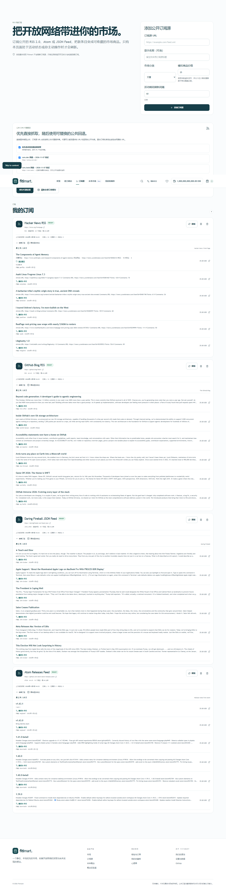

# Fitimart

**静态优先、由 RSS 驱动的实验性内容市场，并带有可配置的虚拟经济。**

[English](README.md) · [在线演示](https://styayur.github.io/fitimart/) · [路线图](https://github.com/styayur/fitimart/issues/25) · [架构文档](docs/ARCHITECTURE.md)

**Fitimart 仅为模拟。** 它不处理真实资金，不销售真实服务访问权，不创建加密货币，也不授予资产所有权。公共订阅源、CORS 代理和机器翻译均为第三方尽力而为服务，其可用性、限制与隐私政策分别适用。



## v0.2.0-alpha.1 主要变化

- 从 Mini Market 正式迁移为 **Fitimart**。
- 支持 RSS 2.0、Atom 与 JSON Feed 订阅，并使用稳定键去重。
- 支持浏览器直接抓取、可替换公共 CORS 代理回退、IndexedDB 缓存恢复。
- 每个导入商品保留源订阅、原始 URL、作者、发布时间、语言与抓取时间。
- 使用 BigInt 支持的六位小数精确金额，序列化时只保存字符串。
- 可配置初始额度、ISO 4217/自定义显示单位、精度与货币格式。
- 自动检测浏览器语言，支持手动覆盖、英文/简体中文界面，以及可选的 MyMemory 内容翻译。
- 购买成功金币动画、余额动画、收据、收藏更新与重复结算保护。
- `mini-market-demo-v1` 版本化迁移、可恢复备份、用户数据导出/导入。
- 验证 GitHub Pages 子路径静态导出，并提供定期真实服务验收流程。

## 快速体验

1. 打开 **订阅源**，添加一个公开 RSS、Atom 或 JSON Feed。
2. 查看导入条目、来源信息、源语言与可选机器翻译。
3. 将精选或导入商品加入购物袋，完成模拟结算。
4. 查看精确收据、收藏库、钱包活动、语言偏好和经济设置。

新钱包默认拥有 **1,000,000,000,000 USD（10^12）** 虚拟额度。修改初始额度设置只影响未来新钱包；重置当前钱包是一个独立的显式操作，并会保留和记录历史。

## 模拟边界

- 余额、订单、收据、补充与支持记录全部为本地模拟数据。
- 不接入真实支付、金融账户、资产权益或真实服务权限。
- 切换显示货币不会兑换余额，也不会虚构汇率。
- 导入内容的所有权仍归原发布者。模拟通行证不会解锁付费内容或真实服务。
- 公共代理和 MyMemory 可能依据各自政策接触请求 URL 或提交文本。

## 本地开发

使用 Node.js 24（与 CI 一致）：

```powershell
git clone https://github.com/styayur/fitimart.git
cd fitimart
npm ci
npm run dev
```

完整验证：

```powershell
npm test
npm run typecheck
npm run lint
npm run build
python -m pip install -r scripts/requirements-browser.txt
python -m playwright install chromium
python scripts/check_browser.py
```

真实服务验收与确定性 fixture 测试分开运行：

```powershell
npm run test:live
```

该脚本会测试多个独立公共订阅源、两个公共代理端点、RSS/Atom/JSON Feed 导入、RSS 商品进入市场，以及一次真实 MyMemory 翻译。结果会随第三方可用性和额度变化。

### GitHub Pages 子路径

静态导出目录为 `out/`，不要使用 `next start` 预览：

```powershell
$env:NEXT_PUBLIC_BASE_PATH = "/fitimart"
npm run build
python tests/pages-subpath.spec.py
```

推送到 `main` 后由 Pages 工作流部署。正式地址：<https://styayur.github.io/fitimart/>。

## 架构

```text
app/                         静态路由、订阅管理、导入商品详情
components/                  界面与客户端市场 Provider
data/                        人工维护目录与未来概念
lib/
  money.ts                   精确定点金额计算与格式化
  commerce.ts                纯结算函数
  storage.ts                 v2 schema、旧数据迁移、导入导出
  catalog-service.ts         精选 + RSS + 已保留商品的统一目录
  feed/
    parser.ts                RSS 2.0、Atom、JSON Feed 校验与解析
    proxy-service.ts         直接请求 → 代理适配器 → 缓存恢复
    feed-cache.ts            IndexedDB 原始响应缓存
    feed-service.ts          刷新策略、去重、状态与退避
  translation/               可替换翻译提供商与翻译缓存
  services/                  钱包、订单、收藏与存储服务
types/                       市场、订阅源与经济类型
tests/                       fixture 测试与浏览器验收
```

详见 [架构说明](docs/ARCHITECTURE.md)、[RSS 指南](docs/RSS.md)、[代理说明](docs/PROXY-PROVIDERS.md)、[翻译说明](docs/TRANSLATION.md)、[货币规范](docs/ECONOMY.md) 和 [迁移报告](docs/MIGRATION.md)。

## 数据、隐私与迁移

- 当前主存储键为 `fitimart-marketplace-v2`。
- 旧键 `mini-market-demo-v1` 会被安全读取并迁移，余额、订单、交易、收藏、关注概念、收藏库、自建概念和支持记录不会被重置。
- 原始订阅响应缓存在 IndexedDB；订阅与商品元数据使用带版本的本地存储。
- URL 检查会阻止凭据、非 HTTP(S) 协议、localhost、私有与内部地址字面量。
- 导入 HTML 会在渲染前转换为纯文本，绝不注入外部 HTML。
- 可在 **设置** 中导出/导入数据；JSON 不直接序列化 BigInt。
- 清除浏览器存储会删除本地体验；本项目没有账户、跨设备同步或后端结算权威。

## 已知限制

- 公共代理与 MyMemory 不保证可用性、延迟、额度或语言覆盖。
- 浏览器端无法彻底解决 DNS rebinding；请勿订阅私有端点。
- 订阅刷新仅在用户操作或标签页可见时运行。
- alpha 每次刷新最多解析最新 40 条，并保留此前已导入条目。
- 界面目前提供英文与简体中文；内容翻译受 MyMemory 支持范围限制。
- 没有多标签页交易锁、后端结算权威或真实权益交付。
- 真实服务验收仅为特定时间点的观察结果，不构成服务承诺。

## 参与与安全

请阅读 [CONTRIBUTING.md](CONTRIBUTING.md) 和 [SECURITY.md](SECURITY.md)。安全问题请私下报告；不要在公共代理请求中放入 API 密钥、私有订阅 URL 或个人信息。

## 许可证

[Mozilla Public License 2.0](LICENSE)。第三方名称、订阅源及其内容仍受各自权利人与条款约束。
